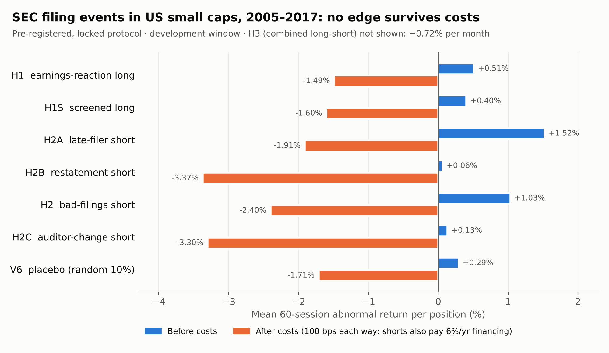

# Filing-events study: do SEC filings give a tradable edge in US small caps?

**Short answer: no.** Under a protocol written and cryptographically locked before any return was computed, none of seven hypotheses built on SEC filing events produced a tradable edge in US small caps from 2005 to 2017 at retail trading costs. A placebo of randomly chosen earnings events earned about the same as the "signal" before costs.



## The question

Three well-known ideas, tested together under one pre-registered protocol:

- **Earnings-reaction continuation (H1, H1S).** After a strong 3-day reaction to an earnings 8-K (Item 2.02), does the move keep going? Buy the top decile at the close of day +3 and hold 60 trading days. H1S excludes companies with a bad filing in the prior year.
- **Bad-filing drift (H2A, H2B, H2, H2C).** After a late-filing notice (NT 10-K/Q), a non-reliance restatement (Item 4.02) or an auditor change (Item 4.01), does the stock keep falling? Short from the close of day +1.
- **Both together (H3).** A 50/50 long-short portfolio.

Universe: US exchange-listed common stocks, at least $2, average daily dollar volume $200k–$20m. Abnormal returns are measured against an equal-weighted benchmark of the same dollar-volume quintile. Costs are retail: longs bought as shares at 100 bps each way; shorts as CFDs at 100 bps each way plus 6% a year financing.

## Results (development window 2005–2017)

| Trial | Hypothesis | Positions | Gross | Net | Verdict |
|---|---|---|---|---|---|
| P1 | H1 earnings-reaction long | 4,442 | +0.51% | −1.49% | FAIL |
| P2 | H1S screened long | 3,918 | +0.40% | −1.60% | FAIL |
| P3 | H2A short late filers | 811 | +1.52% | −1.91% | Inconclusive (too few events) |
| P4 | H2B short restatements | 354 | +0.06% | −3.37% | Inconclusive |
| P5 | H2 short bad filings | 994 | +1.03% | −2.40% | Inconclusive |
| P6 | H3 50/50 long-short | 5,436 | +0.61% | −0.72% per month (portfolio) | FAIL |
| E1 | H2C short auditor changes (exploratory) | 636 | +0.13% | −3.30% | Inconclusive |
| V6 | Placebo: random 10% of earnings events | 4,500 | +0.29% | −1.71% | (engine check) |

Mean 60-session abnormal return per position, signed so that positive means the trade made money. A **PASS** needed all three of: a 95% interval for the net return above zero, a calendar-time Newey–West t above 2, and a deflated Sharpe ratio of at least 0.95 across the full 17-trial budget. The result then had to repeat on a separate validation window. Nothing reached that stage, so the validation (2018–2021) and sealed (2022+) windows were never opened.

Every result stays negative at estimated bid-ask spreads, at doubled costs, with outliers trimmed, and under every survivorship scenario. Full numbers: [`docs/FINAL_REPORT.md`](docs/FINAL_REPORT.md) and [`results/experiments_dev.json`](results/experiments_dev.json).

**Why:** the effects are small (the biggest, shorting late filers, is +1.5% over three months and not reliably above zero), retail round-trip costs are about 2% for longs and 3.4% for CFD shorts, and bad news is largely priced within a day.

## What the work was mostly about: getting the data right

Most of the effort went into making sure a positive result, had there been one, could be believed.

- **Wrong timestamps.** SEC's bulk file reports acceptance times that, for over 99% of filings checked, were in UTC (38%) or converted to UTC twice (62%), not New York time. Left alone, this would have put day 0 one session late for 27.7% of events. The fix reads the true time from each filing's SEC index page: 96,439 filings, 100% verified, and a 300-filing hand-checked fixture reproduced exactly.
- **Survivorship.** Free price data only covers companies that survived; just 42% of listed-at-event earnings events had prices in 2005–2017. The engine reports favourable, central and adverse bounds for every result, using a delisting table built from SEC Forms 25 and 15 and a cause rule audited by hand. The rule failed its second audit (88.9% against a 90% bar set in advance), so the protocol adds a 10% label-error allowance rather than relaxing the bar.
- **Bad prints.** The engine sums daily returns, so a one-day print that reverses (+100% then −50%) would add about 50 points. 617 price masks (611 reversing days, plus 6 hand-checked SPAC or shell periods) were chosen by rules fixed before the evidence was collected.
- **Discipline.** A frozen run order, a trial registry that refuses repeats, a deflated Sharpe over all 17 planned trials, a placebo check, and a sealed holdout that was never needed.

## Repository

| Path | What it is |
|---|---|
| `fe/events.py` | Event-study engine: day-0 rules (NYSE calendar, 30-minute dissemination buffer), selection, de-duplication, costs, inference (block bootstrap, Newey–West, deflated Sharpe), survivorship bounds |
| `fe/data.py`, `fe/smallcap_schema.sql` | DuckDB schema, SEC bulk-file parsers, delisting-cause view, SEC acceptance-time fetcher, exclusions and price masks |
| `fe/protocol.py`, `fe/registry.py`, `fe/run.py` | Pre-registration (SHA-256 lock), trial registry, command line |
| `research/filing_events_v1.toml` | The locked protocol: byte-identical to the file that was pre-registered (SHA-256 `e3f4a2fd…fe67d`, see `config/protocols.lock`). Its comments refer to the original private project |
| `config/smallcap_price_masks.csv` | The 617 price masks, each with its reason |
| `results/experiments_dev.json` | All eight recorded runs with full detail (monthly series, cost stresses, bounds) |
| `docs/` | Final report and the working records: readiness checks, delisting audits, price review, lock record |
| `tests/` | 47 tests on synthetic data |

```bash
pip install -e ".[dev]"
pytest -q                                   # synthetic data only; no market data needed
python -m fe.run status research/filing_events_v1.toml --db data/smallcap.duckdb
```

**Data is not included.** SEC filings are public (see [`docs/DATA.md`](docs/DATA.md) for how the database is built). Daily prices came from a free source whose terms do not allow redistribution, so reproducing the runs needs your own price table in the documented schema.

## Limits

The result covers these definitions: daily data, entry one or three sessions after the filing, 60-session holds, retail costs, and companies with surviving price history. It says nothing about intraday reactions or institutional cost levels.

## Licence

MIT. See `LICENSE`.
